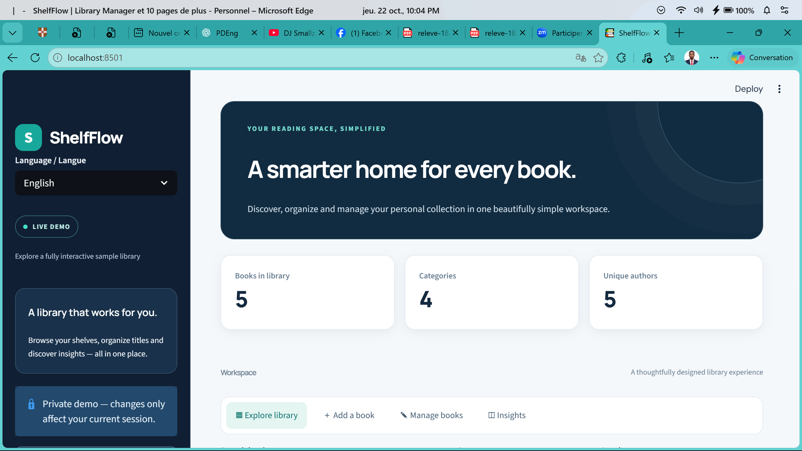
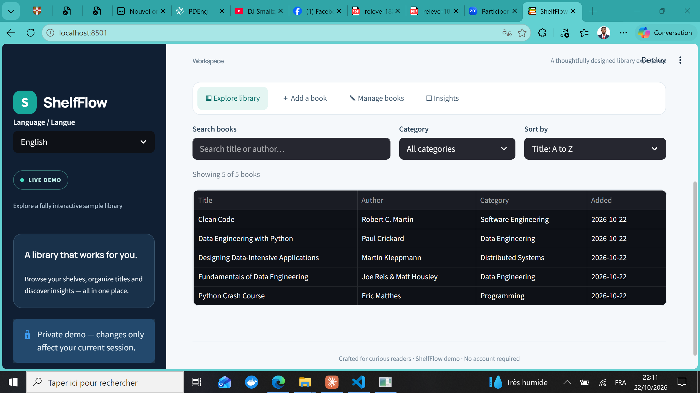
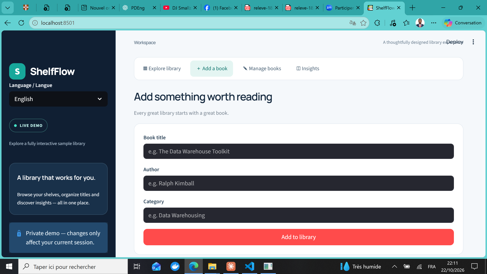
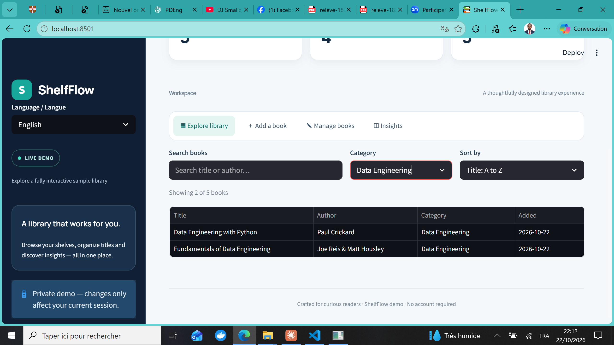

# ShelfFlow -- Systeme de Gestion de Bibliotheque Personnelle

> **Outils :** Python 3.x, Streamlit, pandas, pytest, JSON  
> **Duree :** ~8 heures

---

## Problematique metier

Un developpeur ou un data engineer a besoin d'un systeme fiable pour gerer une collection de livres techniques. Le systeme doit supporter les operations CRUD completes, persister les donnees en JSON, valider les entrees et offrir une interface utilisateur moderne et bilingue.

---

## Objectifs du projet

- Concevoir une architecture Python modulaire (classes, modules, separation des responsabilites)
- Implementer un CRUD complet avec persistance JSON et ecriture atomique
- Creer une interface web interactive avec Streamlit (bilingue FR/EN)
- Ecrire une suite de tests unitaires et de robustesse avec pytest
- Gerer les cas limites : doublons, champs vides, JSON corrompu, fichiers manquants

---

## Outils et competences mobilisees

| Categorie | Technologies |
|-----------|-------------|
| Langage | Python 3.x |
| Interface | Streamlit |
| Donnees | JSON, pandas |
| Tests | pytest (14 tests unitaires + robustesse) |
| Architecture | POO (classes Book, Library), modules separes |
| Persistance | Ecriture atomique (tempfile + os.replace) |
| Validation | Deduplication case-insensitive, champs obligatoires |

---

## Le dataset

Donnees de demonstration integrees a l'application :

| Champ | Description |
|-------|-------------|
| title | Titre du livre |
| author | Auteur |
| category | Categorie (Data Engineering, Programming, etc.) |
| date_added | Date d'ajout (ISO 8601) |

Collection initiale : 5 livres techniques (Fundamentals of Data Engineering, Designing Data-Intensive Applications, Python Crash Course, Clean Code, Data Engineering with Python).

---

## L'application

### Dashboard principal


*Interface principale avec KPIs (livres, categories, auteurs), hero bilingue et navigation par onglets.*

### Exploration de la bibliotheque


*Tableau interactif avec recherche, filtrage par categorie et tri multi-criteres.*

### Ajout de livres


*Formulaire valide avec detection de doublons et feedback utilisateur.*

### Statistiques


*Graphique horizontal des livres par categorie, actualise en temps reel.*

---

## Fonctionnalites principales

| Fonctionnalite | Description |
|----------------|-------------|
| CRUD complet | Ajouter, lire, mettre a jour, supprimer des livres |
| Recherche | Par titre ou auteur (case-insensitive) |
| Tri | Par titre, categorie, date (ascendant/descendant) |
| Validation | Champs obligatoires, detection de doublons |
| Persistance | Ecriture atomique avec fichier temporaire + os.replace |
| Interface bilingue | Anglais et francais (Streamlit) |
| Session isolee | Chaque utilisateur a sa propre session demo |
| Interface CLI | Menu interactif en ligne de commande (src/main.py) |

---

## Architecture et bonnes pratiques

### Ecriture atomique

La sauvegarde utilise `tempfile.NamedTemporaryFile` + `os.fsync` + `os.replace` pour garantir qu'aucune donnee n'est perdue en cas de crash pendant l'ecriture.

### Validation robuste

- Champs vides rejetes avec messages d'erreur clairs
- Doublons detectes en comparaison case-insensitive
- JSON corrompu ou structure invalide detectes au chargement
- Les mises a jour echouees preservent l'etat original (rollback)

### Tests

14 tests couvrant :
- Operations CRUD de base (8 tests)
- Cas limites et robustesse (6 tests) : champs vides, doublons, JSON corrompu, structure invalide, mises a jour conflictuelles, fichiers manquants

---

## Competences demontrees

- Programmation orientee objet en Python
- Architecture modulaire (separation modele/vue/controleur)
- Persistance de donnees avec ecriture atomique
- Validation et gestion d'erreurs robuste
- Tests unitaires et tests de robustesse avec pytest
- Interface utilisateur moderne avec Streamlit
- Internationalisation (i18n) bilingue
- Design d'interface (CSS custom, responsive)

---

## Structure du projet

```
01-python-library-management/
├── app.py                    # Interface Streamlit (bilingue)
├── requirements-ui.txt       # Dependances Streamlit
├── requirements.txt          # Dependances de base
├── data/
│   └── books.json            # Donnees persistees (JSON)
├── src/
│   ├── __init__.py
│   ├── book.py               # Classe Book
│   ├── library.py            # Classe Library (CRUD + validation)
│   └── main.py               # Interface CLI
├── tests/
│   ├── test_library.py       # Tests unitaires (8 tests)
│   └── test_robustness.py    # Tests de robustesse (6 tests)
└── images/
    ├── dashboard.png
    ├── library.png
    ├── add-book.png
    └── insights.png
```

---

## Pour reproduire

```bash
git clone https://github.com/barde44/portfolio-data-engineer.git
cd portfolio-data-engineer/01-python-library-management

# Interface Streamlit
pip install -r requirements-ui.txt
python -m streamlit run app.py

# Interface CLI
python -m src.main

# Tests
pip install pytest
pytest tests/ -v
```

---

## A propos

Projet realise par **Steven Barde** dans le cadre du portfolio Data Engineer.  
[github.com/barde44/portfolio-data-engineer](https://github.com/barde44/portfolio-data-engineer)
