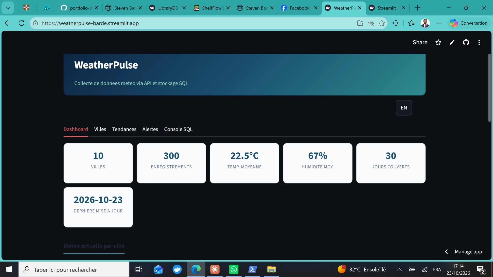
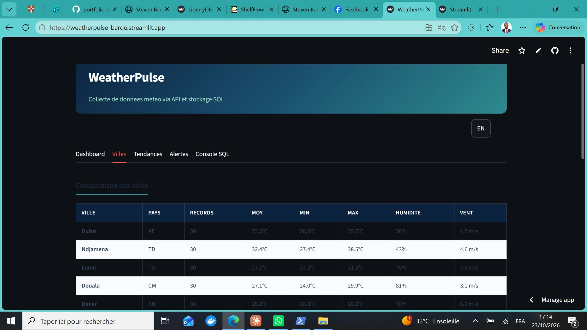
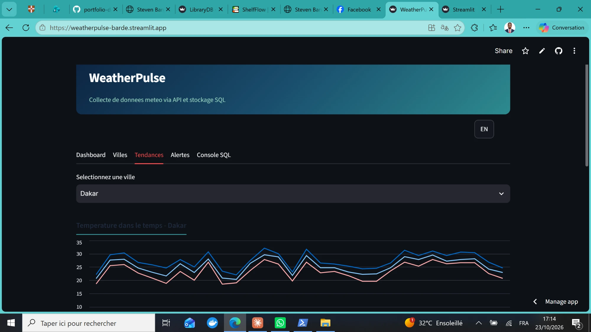
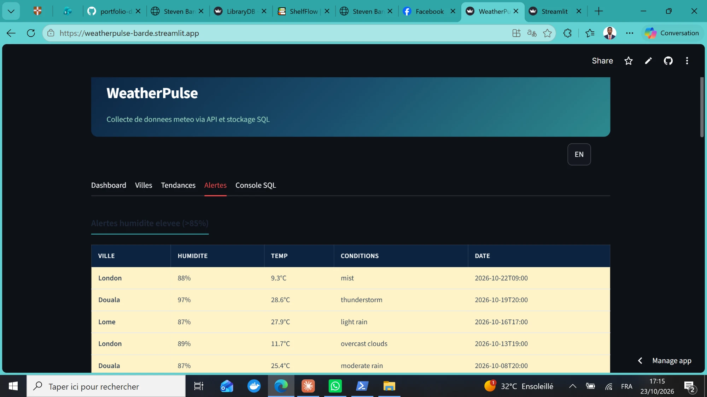
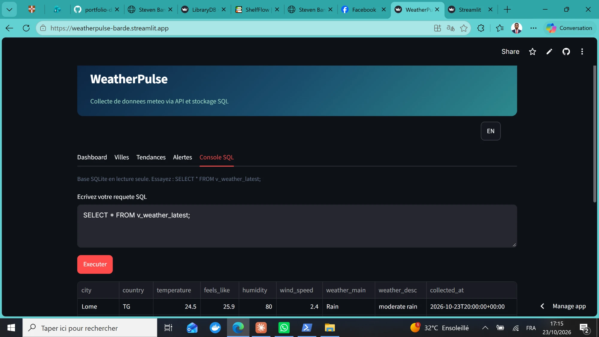

# WeatherPulse -- Weather API Data Collection & SQL Storage

A weather data collection system that connects to the OpenWeatherMap API, retrieves real-time meteorological data for 10 cities across 4 continents, cleans and normalizes the JSON responses, and stores everything in a structured SQLite database. An interactive Streamlit dashboard provides visualization and analytics.

## Business Context

A tourism company wants to automate weather data collection for its destinations to provide personalized travel recommendations based on current and historical weather conditions.

## Architecture

```
OpenWeatherMap API
       |
       v
  collector.py  ─── requests ── JSON response
       |
       v
  parse & clean  ─── normalize temperatures, timestamps, conditions
       |
       v
  SQLite Database  ─── 2 tables, 3 indexes, 3 views
       |
       v
  Streamlit App  ─── Dashboard, City stats, Trends, Alerts, SQL Console
```

## Database Schema

| Table | Description |
|-------|-------------|
| `cities` | 10 tracked cities with coordinates (name, country, lat, lon) |
| `weather_records` | Weather measurements (temp, humidity, wind, conditions, timestamps) |

| View | Description |
|------|-------------|
| `v_weather_latest` | Most recent weather reading per city |
| `v_weather_stats` | Aggregated statistics per city (avg/min/max temp, humidity, wind) |
| `v_daily_summary` | Daily aggregations with condition breakdown |

| Index | Purpose |
|-------|---------|
| `idx_weather_city` | Fast lookups by city |
| `idx_weather_date` | Fast time-range queries |
| `idx_weather_city_date` | Composite index for city + date filtering |

## SQL Queries Implemented

| Query | Description |
|-------|-------------|
| Q1 | Current weather for all tracked cities |
| Q2 | Temperature extremes per city (coldest, hottest, range) |
| Q3 | Average conditions by city (temp, humidity, wind, pressure) |
| Q4 | Daily temperature evolution for a specific city |
| Q5 | Most frequent weather conditions per city with percentage |
| Q6 | Humidity alerts (readings above 85%) |
| Q7 | Wind speed ranking across cities |
| Q8 | Collection activity log (records per day) |

## Cities Tracked

| City | Country | Climate Profile |
|------|---------|-----------------|
| Lome | Togo | Tropical humid (28°C avg) |
| Ndjamena | Chad | Hot semi-arid (33°C avg) |
| Paris | France | Oceanic temperate (14°C avg) |
| New York | USA | Humid continental (16°C avg) |
| Douala | Cameroon | Equatorial (27°C avg) |
| Dakar | Senegal | Hot semi-arid (25°C avg) |
| Nairobi | Kenya | Subtropical highland (20°C avg) |
| London | UK | Oceanic temperate (12°C avg) |
| Tokyo | Japan | Humid subtropical (18°C avg) |
| Dubai | UAE | Hot desert (34°C avg) |

## Dashboard


*Global KPIs (10 cities, 300 records, average temperature) and current weather table with conditions per city.*

## City Statistics


*Comparative statistics: average, minimum and maximum temperatures, humidity, wind speed across all cities.*

## Temperature Trends


*Daily temperature and humidity evolution for a selected city over the collection period.*

## Alerts


*High humidity alerts (>85%) and wind speed ranking across cities.*

## SQL Console


*Interactive console for executing custom SQL queries on the read-only database.*

## Project Structure

```
03-api-weather-data/
  collector.py          # API data collector with demo mode
  app.py                # Streamlit interactive dashboard
  requirements.txt      # Python dependencies
  sql/
    schema.sql          # Database schema (tables, indexes, views)
    queries.sql         # 8 analytical SQL queries
  data/
    weather.db          # SQLite database (generated)
    collector.log       # Collection logs
  images/
    dashboard.png       # Dashboard screenshot
    cities.png          # City comparison screenshot
    trends.png          # Trends screenshot
    alerts.png          # Alerts screenshot
    console-sql.png     # SQL Console screenshot
```

## Setup

```bash
pip install -r requirements.txt

# Generate sample data (no API key needed)
python collector.py --demo

# Or collect real data with OpenWeather API key
python collector.py --api-key YOUR_API_KEY

# Launch the dashboard
streamlit run app.py
```

## Tools and Skills

| Category | Technologies |
|----------|-------------|
| Language | Python 3.x |
| API | OpenWeatherMap (REST, JSON) |
| Database | SQLite |
| Analysis | pandas |
| Interface | Streamlit |
| HTTP | requests |
| Schema | 2 tables, 3 views, 3 indexes |
| Queries | JOINs, aggregations, window functions, subqueries |

## Skills Demonstrated

- REST API integration (HTTP GET, query parameters, JSON parsing)
- Data cleaning and normalization (timestamps, units, null handling)
- Relational database design with foreign keys and indexes
- Advanced SQL queries (JOINs, GROUP BY, window functions, subqueries)
- SQL views for encapsulating analytical logic
- Interactive data visualization with Streamlit
- Bilingual interface (FR/EN)
- Logging and error handling for data pipelines
- Modular code architecture (collector / storage / visualization)
